# 대용량 데이터 고속 처리의 5가지 핵심 원리

> 데이터를 SRAM에 미리 준비하고, 적절한 크기로 나누어 여러 연산기가 동시에 계산하며,  
> 한 번 가져온 데이터는 최대한 재사용하고, 다음 데이터 로딩과 현재 연산을 겹쳐서 처리한다.

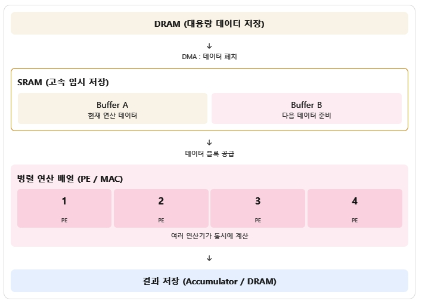

| 설계 요소	| 해결하려는 문제 | 
|:-------:|:-------:|
| SRAM	| 데이터 접근 속도 향상 | 
| 블록 분할(Tile)	| 메모리와 연산 자원의 효율적 활용 | 
| 병렬 연산(PE/MAC)	| 연산 처리량 증가 | 
| 데이터 재사용	| 메모리 접근 및 전력 감소 | 
| 파이프라이닝	| 데이터 로딩과 연산 사이의 대기 시간 감소 | 

1. SRAM을 활용해 연산과 데이터 페치를 연속적으로 수행한다.
- DRAM에서 데이터를 미리 SRAM으로 가져옵니다.
- 현재 데이터를 연산하는 동안 다음 데이터를 SRAM에 준비합니다.
- Double Buffering 등을 활용해 데이터 로딩과 연산이 끊기지 않도록 합니다.
- 목적: 연산 장치가 데이터를 기다리는 시간을 최소화한다.

2. 데이터를 적절한 크기의 블록(Tile)으로 나눈다.
- 데이터 전체를 한 번에 처리하기보다 작은 블록 단위로 분할합니다.
- SRAM 용량, 연산기 개수, 데이터 재사용 가능성 등을 고려해 블록 크기를 결정합니다.
- 블록이 너무 크면 SRAM에 들어가지 않고, 너무 작으면 데이터 이동 및 제어 오버헤드가 커질 수 있습니다.
- 목적: 메모리와 연산 장치에 가장 적합한 크기로 나누어 처리한다.

3. 여러 개의 연산 블록(PE/MAC)을 병렬로 사용한다.
- 데이터를 여러 연산기에 나누어 동시에 계산합니다.
- 연산기가 많아지면 단위 시간당 처리량(Throughput)을 높일 수 있습니다.
- 다만 연산기에 데이터를 충분히 공급할 수 있어야 하며, SRAM 대역폭과 전력도 고려해야 합니다.
- 목적: 동일한 시간에 더 많은 연산을 수행한다.

4. 한 번 가져온 데이터를 최대한 재사용한다.
- SRAM에 가져온 입력 데이터나 가중치를 여러 번 계산에 활용합니다.
- 예를 들어 같은 가중치를 여러 입력 데이터에 반복해서 사용합니다.
- 매번 DRAM에서 다시 읽는 것보다 데이터 이동 시간과 전력 소모를 줄일 수 있습니다.
- 목적: 데이터 이동은 줄이고 실제 연산 비율은 높인다.

5. 데이터 이동과 연산을 동시에 진행한다.
- DMA가 다음 데이터를 가져오는 동안 PE/MAC은 현재 데이터를 계산합니다.
- 계산이 끝나면 준비된 다음 블록으로 바로 넘어갑니다.
- 목적: 메모리 대기 시간과 연산 유휴 시간을 최소화한다.

---

# AI Accelerator 행렬 연산과 하드웨어 구조 이해

## Block Matrix Multiplication · VTA Block GEMM · GPU/NPU · FPGA/ASIC 확장

> 이 문서는 두 개의 시뮬레이터(`_01_block_matmul_math_sim.html`, `_02_vta_block_gemm_sim.html`)를 바탕으로, 앞선 설명에서 다룬 개념과 확장 방향을 최대한 보존해 정리한 학습 자료입니다. 원본 HTML의 수치·동작 설명과 일반적인 GPU/NPU 하드웨어 배경 설명은 구분해서 읽어야 합니다.

---

# 1. 두 시뮬레이터의 핵심 내용

두 파일은 단순히 GPU나 NPU가 행렬을 곱하는 방법을 설명하는 것을 넘어, AI 반도체가 어떻게 계산을 병렬화하고 메모리를 효율적으로 사용하여 연산 속도를 높이는지 이해하도록 돕습니다.

첫 번째는 **연산 구조(Compute Architecture)**를, 두 번째는 **메모리 구조와 데이터 이동(Data Movement)**을 이해하는 데 초점이 있습니다.

> AI 반도체의 성능은 단순히 곱셈을 얼마나 빠르게 하느냐가 아니라,   얼마나 많은 데이터를 동시에 계산하고, 계산에 필요한 데이터를 얼마나 효율적으로 공급하느냐에 달려 있습니다.

## 1.1 첫 번째: Block Matrix Multiplication Simulator

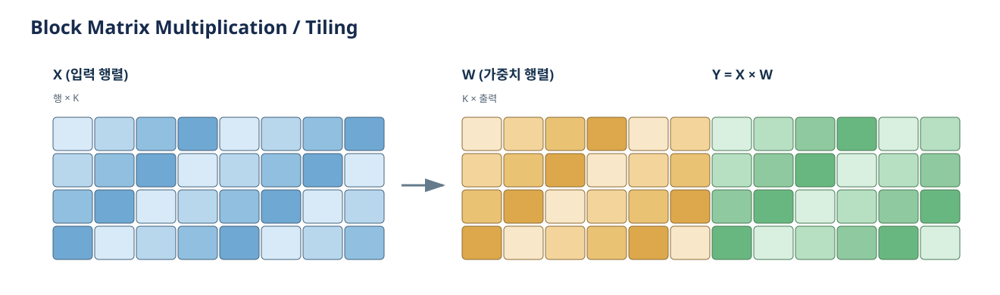

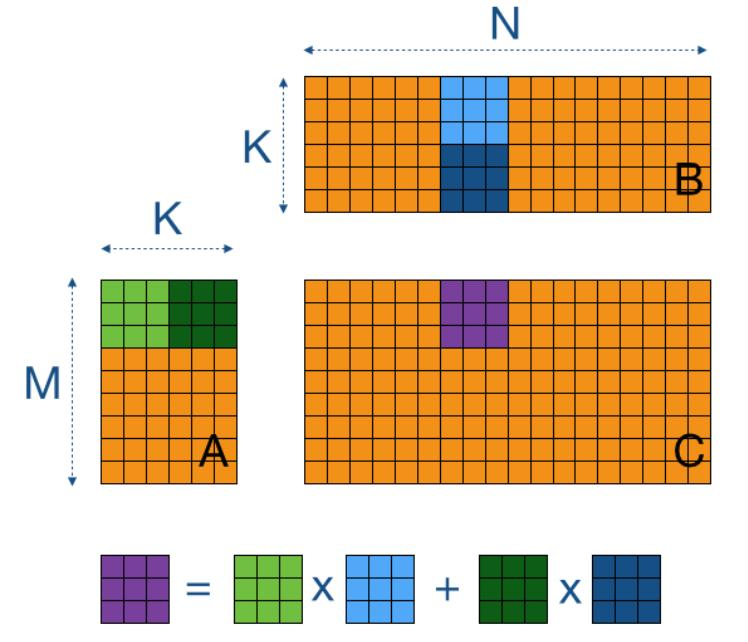

**핵심: 연산 구조 이해**

- 행렬을 작은 블록(Tile)으로 분할
- 여러 곱셈을 동시에 수행
- BATCH 크기에 따른 병렬성 변화
- 동일한 연산을 어떻게 묶어서 처리할지 이해

기본 수식은 다음과 같습니다.

$$
Y=X\times W
$$

- X: 입력 데이터
- W: 가중치(Weight)
- Y: 연산 결과

예를 들어 입력 행렬이 4×16이고 가중치 행렬이 16×8이라면 결과는 4×8입니다.

전체 행렬을 한 번에 계산하는 것이 아니라 작은 단위로 분할합니다.

| 구분 | 의미 |
|---|---|
| BLOCK_IN | 입력 데이터 묶음 크기 |
| BLOCK_OUT | 출력 데이터 묶음 크기 |
| BATCH | 동시에 처리하는 입력 행의 수 |
| Tile | 실제 계산을 수행하는 작은 행렬 블록 |

### BATCH의 의미

- BATCH=1: 한 행씩 처리
- BATCH=2: 두 행을 동시에 처리
- BATCH=4: 네 행을 동시에 처리

시뮬레이터의 예제에서는 4개 행을 각각 처리하는 경우와 4개 행을 동시에 처리하는 경우를 비교합니다.

동일한 512회의 곱셈을 수행하더라도 BATCH=4에서는 블록 연산 횟수가 32회에서 8회로 감소합니다. 대신 한 번에 필요한 곱셈기도 증가합니다.

즉, **연산 횟수를 줄이는 것이 아니라 연산을 병렬로 배치하는 방법을 바꾸는 것**입니다.

원본 시뮬레이터의 단계별 설명은 다음과 같습니다.

| 단계 | 구성 | 의미 |
|---|---|---|
| ① | 블록 1×1 | 원소 하나의 곱셈·누산을 기본 단위로 수행 |
| ② | 입력 블록 2 | 길이 2의 내적 단위로 묶음 |
| ③ | 입력 블록 4 | 길이 4의 내적 단위로 묶음 |
| ④ | 출력 블록 2 | 출력 원소 2개를 동시에 생성 |
| ⑤ | 입력 4 × 출력 4 | 출력 원소 4개를 동시에 생성 |
| ⑥ | 행 2개, BATCH=1 | 두 행을 서로 다른 스텝에서 처리 |
| ⑦ | 행 4개, BATCH=1 | 네 행을 시간에 걸쳐 처리하며 가중치 재사용 |
| ⑧ | 행 4개, BATCH=2 | 두 행씩 동시에 처리 |
| ⑨ | 행 4개, BATCH=4 | 네 행을 동시에 처리 |

특히 ⑦과 ⑨의 비교가 중요합니다. ⑦은 같은 W 단위를 네 번의 스텝에서 다시 사용하지만, ⑨는 한 번의 블록 곱에서 네 행이 동시에 사용합니다. ⑨는 ⑦보다 블록 곱 횟수가 줄지만 동시에 필요한 곱셈기는 늘어납니다.

시뮬레이터 설명에 따르면 GPU Tensor Core나 Systolic Array는 이러한 행렬×행렬 블록 연산 구조와 연결해 이해할 수 있습니다. VTA 기본 설정은 곱셈기를 아끼기 위해 BATCH=1 형태를 선택하는 예로 제시되어 있습니다.

## 1.2 두 번째: VTA Block GEMM Simulator

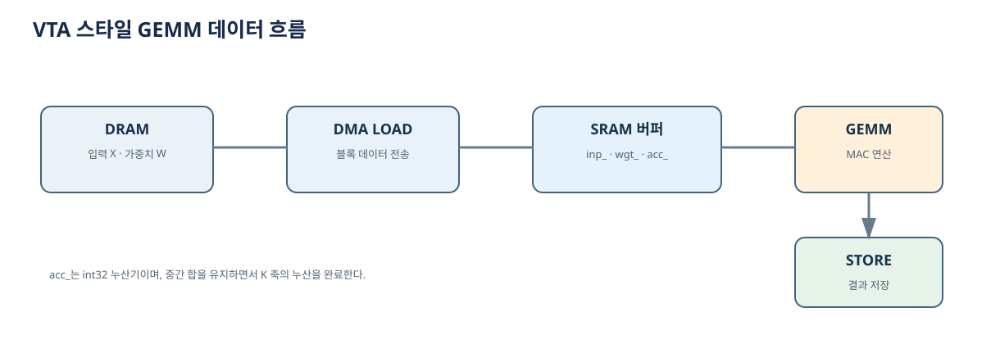

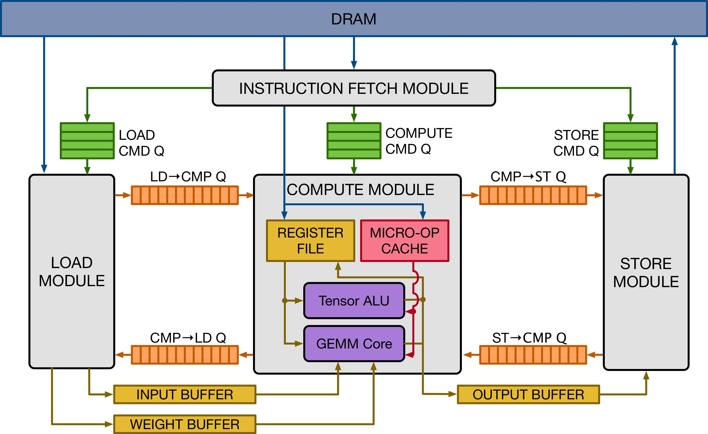

**핵심: 하드웨어 동작과 데이터 이동 이해**

두 번째 시뮬레이터는 첫 번째에서 이해한 블록 연산을 실제 가속기 내부의 데이터 이동과 연결합니다.

| 구성 | 역할 |
|---|---|
| DRAM | 입력 데이터와 가중치 저장 |
| DMA | DRAM과 온칩 버퍼 사이의 데이터 전송 |
| inp_ | 입력 데이터 버퍼 |
| wgt_ | 가중치 버퍼 |
| GEMM | 행렬 곱셈 연산 |
| acc_ | 중간 연산 결과 누적(int32) |
| STORE | 계산 결과를 메모리에 저장 |

실행 흐름은 다음과 같습니다.

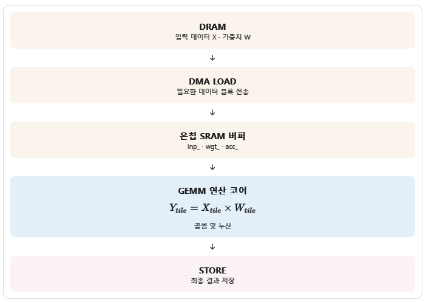

1. DRAM에 저장된 입력 X와 가중치 W를 준비합니다.
2. DMA LOAD로 필요한 데이터 블록을 온칩으로 가져옵니다.
3. SRAM의 `inp_`, `wgt_` 버퍼에 데이터를 배치합니다.
4. GEMM 코어에서 블록 행렬 곱셈을 수행합니다.
5. `acc_` 누산기에 중간 결과를 누적합니다.
6. 계산이 완료된 결과를 STORE로 내보냅니다.

### 데이터 재사용(Data Reuse)

예를 들어 같은 가중치 W를 4개의 입력 행이 사용한다고 가정합니다.

- 비효율적인 방법: 가중치를 4번 읽어옵니다.
- 효율적인 방법: 가중치를 한 번 읽어온 뒤 4개 입력 행이 공유합니다.

두 번째 시뮬레이터는 이러한 차이를 DRAM 접근 횟수와 메모리 트래픽으로 비교합니다.

또한 입력을 고정할지, 가중치를 고정할지에 따라 루프 순서가 달라지고 데이터 재사용 효율도 달라집니다.

### VTA 시뮬레이터의 중요한 세부 사항

- `inp_`: 입력 버퍼
- `wgt_`: 가중치 버퍼
- `acc_`: int32 누산기
- 시뮬레이터 설명에서는 STORE가 int8을 내보내므로 중간 합(int32)을 DRAM에 내릴 수 없다고 설명합니다. 따라서 합산 축 K는 칩 안에서 끝내고 출력 누산을 유지합니다.
- 이 시뮬레이터는 입력 엔트리와 가중치 엔트리의 K 전체가 버퍼에 한꺼번에 들어온다고 단순화합니다.
- LOAD와 GEMM을 겹치지 않고 차례로 실행합니다.
- 실제 VTA에서는 K를 나눠 흘려보내거나 누산기를 칩에 유지할 수 있으며, `virtual_thread` 등을 통해 LOAD와 계산을 겹칠 수 있습니다.
- 시뮬레이터의 이상적인 모델은 직전 타일과 같은 엔트리가 버퍼에 있으면 다시 읽지 않는 것으로 가정합니다. 실제 TVM 코드의 루프와 `compute_at` 배치에 따라 다시 LOAD가 실행되어 트래픽이 더 발생할 수 있습니다.

---

# 2. 가장 기본적인 의미: AI 반도체는 무엇을 하는가?

두 시뮬레이터를 이해하기 위해서는 세 가지 개념을 구분하면 좋습니다.

## 2.1 연산(Compute)

행렬의 각 원소를 곱하고 더하는 작업입니다.

$$
y_j=\sum_{i=0}^{K-1}x_iw_{ij}
$$

이 작업을 수행하는 하드웨어가 MAC(Multiply-Accumulate) 연산기입니다.

$$
MAC=A\times B+C
$$

MAC 연산기가 하나라면 순차적으로 계산하고, MAC 연산기가 수십 개, 수백 개라면 여러 계산을 동시에 수행할 수 있습니다.

## 2.2 병렬성(Parallelism)

동시에 몇 개의 연산을 수행할 수 있는가에 관한 것입니다.

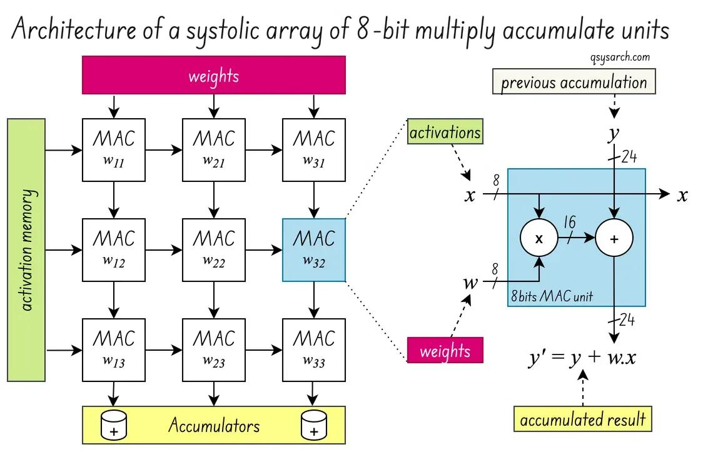

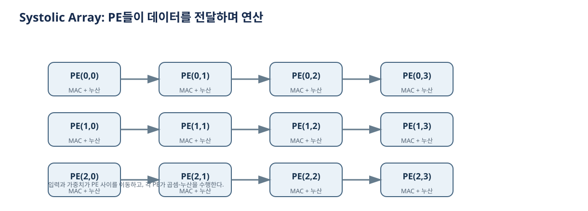

대표적인 구조는 다음과 같습니다.

- Scalar Processing: 하나씩 계산
- SIMD: 하나의 명령으로 여러 데이터를 처리
- Vector Processing: 벡터 단위 연산
- Matrix Processing: 행렬 블록 단위 연산
- Systolic Array: 여러 연산기가 데이터를 전달하면서 연속적으로 계산

첫 번째 시뮬레이터에서 BATCH를 증가시키는 과정은 이러한 병렬 연산 구조를 이해하는 기초가 됩니다.

## 2.3 메모리 계층(Memory Hierarchy)

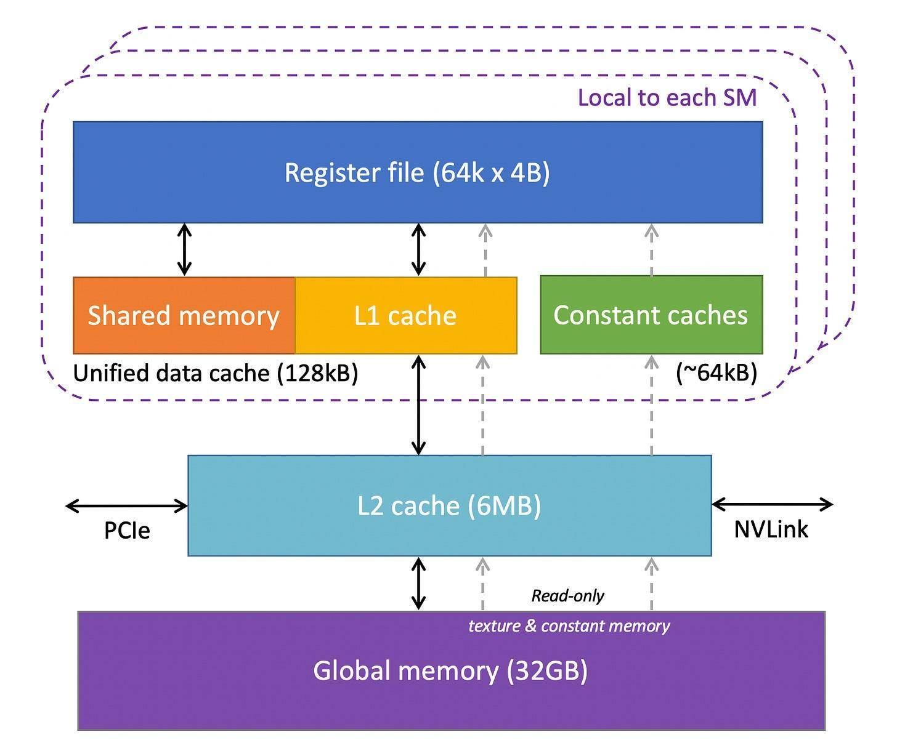

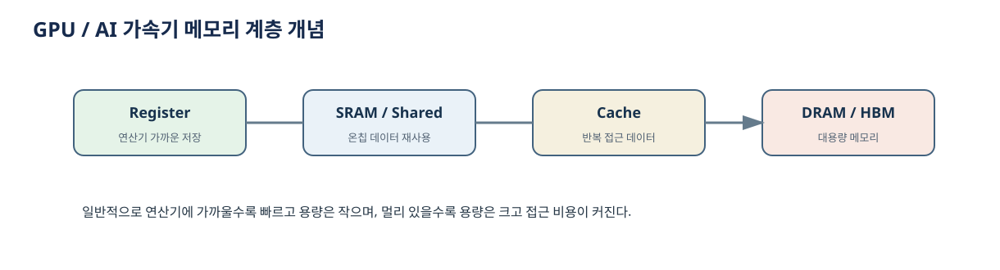

연산기가 아무리 빨라도 데이터를 공급하지 못하면 연산기를 놀리게 됩니다.

| 메모리 | 일반적인 특징 |
|---|---|
| Register | 연산기 바로 옆의 매우 빠른 저장 공간 |
| SRAM / Shared Memory | 칩 내부의 데이터 재사용 공간 |
| Cache | 반복적으로 사용하는 데이터 저장 |
| DRAM / HBM | 대용량 데이터 저장 |

두 번째 VTA 시뮬레이터에서 DRAM과 SRAM을 구분하는 이유가 바로 이것입니다.

**AI 반도체 설계의 핵심은 연산 성능과 메모리 대역폭의 균형입니다.**

---

# 3. GPU와 NPU에서는 어떻게 연결되는가?

주의할 점이 하나 있습니다. 두 파일은 특정 GPU나 NPU의 실제 회로를 그대로 재현한 것은 아닙니다. 두 번째 파일은 VTA(Versatile Tensor Accelerator)의 구조를 단순화한 모델입니다. 다만 GPU와 NPU의 행렬 연산 구조를 이해하는 데 좋은 공통 기반이 됩니다.

## 3.1 GPU (Graphics Processing Unit)

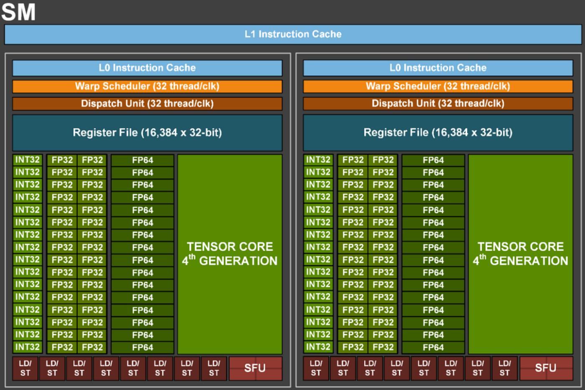

- 대규모 병렬 연산
- CUDA Core 및 Tensor Core
- 다양한 연산을 유연하게 수행
- AI, 그래픽, 과학 계산 등에 활용

## 3.2 NPU (Neural Processing Unit)

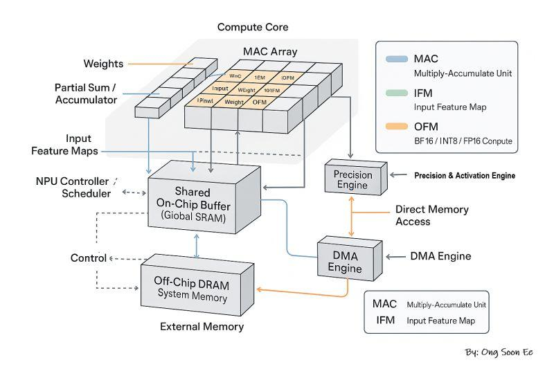

- 신경망 연산에 특화
- MAC 어레이 및 행렬 연산기
- 정수 양자화 연산 활용
- 전력 효율과 연산량 최적화

| 비교 | GPU | NPU |
|---|---|---|
| 기본 목적 | 범용 병렬 연산 | 신경망 연산 최적화 |
| 핵심 연산 | Vector, Matrix | Matrix, MAC |
| 병렬 구조 | 다수의 연산 코어 | 특화된 연산 어레이 |
| 메모리 | Register, Cache, VRAM 등 | SRAM, DRAM 등 |
| 정밀도 | FP32, FP16, BF16, INT8 등 | INT8, INT4 및 FP 계열 등 |
| 특징 | 유연성 | 전력 효율과 특정 연산 최적화 |

실제로는 GPU와 NPU의 구조가 상당히 다양하며, 위 표는 일반적인 경향을 나타냅니다.

---

# 4. 여기서 확장할 수 있는 기술 영역

현재 두 시뮬레이터를 기반으로 확장하면 AI 반도체 교육뿐 아니라 FPGA, RTL 설계, ASIC 설계까지 연결할 수 있습니다.

## 4.1 Level 1. Matrix Mathematics

현재 첫 번째 시뮬레이터와 연결되는 단계입니다.

- Matrix Multiplication
- Block Matrix Multiplication
- Tiling
- Batch Processing
- Parallelism

## 4.2 Level 2. Accelerator Architecture

현재 두 번째 시뮬레이터와 연결되는 단계입니다.

- GEMM Engine
- MAC Array
- SRAM Buffer
- DMA Controller
- Data Reuse

## 4.3 Level 3. Hardware Optimization

- Loop Tiling / Loop Ordering
- Memory Bandwidth
- Double Buffering
- Pipeline
- Compute / Memory Overlap

## 4.4 Level 4. AI Numerical Computing

- FP32 / FP16 / BF16
- INT8 / INT4
- Quantization
- Accumulator Precision
- Saturation / Overflow

## 4.5 Level 5. AI Model Mapping

- CNN Convolution
- Transformer
- Attention / Softmax
- MLP
- Vision Transformer

## 4.6 Level 6. RTL / FPGA / ASIC

- Verilog MAC Unit
- Systolic Array
- SRAM Controller
- DMA RTL
- AXI Interface
- FPGA Prototype
- ASIC Synthesis / PPA

---

# 5. 확장 기술의 구체적인 내용

## 5.1 A. 행렬 연산기 설계

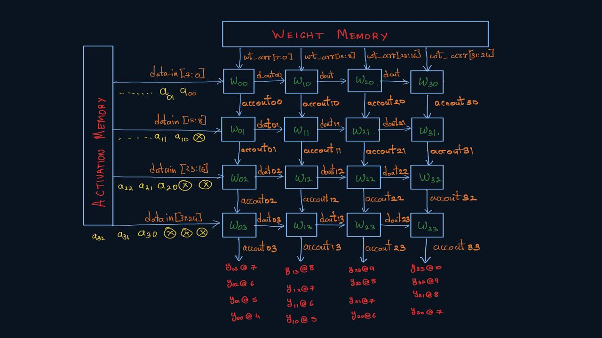

현재 블록 행렬 곱셈을 실제 하드웨어로 구현하는 단계입니다.

확장 항목:

- 2×2, 4×4, 8×8 MAC Array
- Systolic Array
- Weight Stationary
- Output Stationary
- Input Stationary
- PE(Processing Element) 구조

특히 Weight Stationary는 가중치를 연산기 가까이에 유지하고 입력 데이터를 흘려보내는 구조입니다. 이는 두 번째 시뮬레이터의 데이터 재사용 개념과 직접 연결됩니다.

## 5.2 B. 메모리 최적화

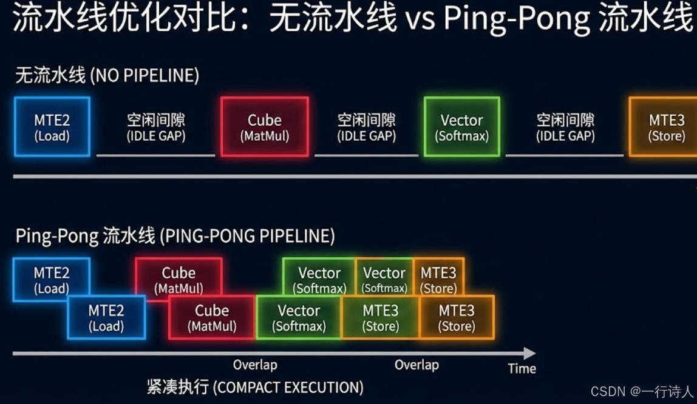

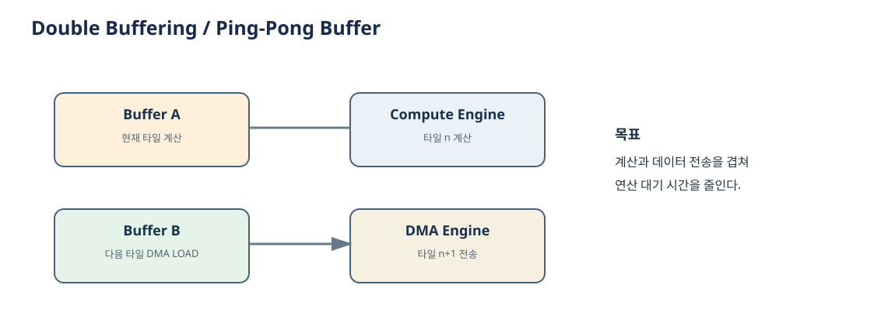

현재 시뮬레이터는 LOAD → GEMM → STORE를 순차적으로 수행합니다. 이를 다음과 같이 확장할 수 있습니다.

- Double Buffering
- Ping-Pong Buffer
- DMA와 연산 동시 실행
- SRAM 용량 최적화
- DRAM Bandwidth 계산
- Memory Access Latency

예를 들어 첫 번째 데이터 블록을 계산하는 동안 두 번째 블록을 DMA로 가져오면 연산 대기 시간을 줄일 수 있습니다.

단, 실제 성능 개선 정도는 데이터 전송 시간과 연산 시간, 버퍼 용량에 따라 달라집니다.

## 5.3 C. 정밀도와 양자화

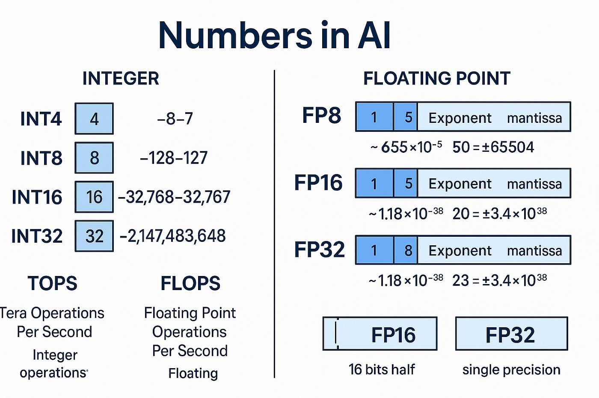

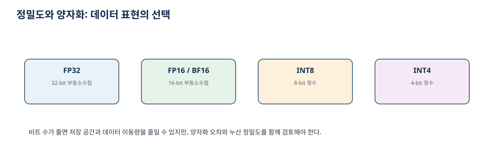

AI 반도체에서는 같은 행렬 연산이라도 데이터 표현 방식에 따라 하드웨어 구조와 성능이 달라집니다.

| 데이터 형식 | 일반적인 용도 |
|---|---|
| FP32 | 정밀한 부동소수점 연산 |
| FP16 | AI 학습 및 추론 |
| BF16 | AI 학습 |
| INT8 | AI 추론 |
| INT4 | 저비트 AI 추론 |

추가 구현 항목:

- INT8 MAC 연산기
- INT4 MAC 연산기
- FP16 MAC 연산기
- INT32 Accumulator
- Overflow 및 Saturation
- Quantization 오차 분석

두 번째 파일에서 int8 데이터를 사용하고 int32 누산기를 사용하는 부분을 출발점으로 삼을 수 있습니다.

## 5.4 D. CNN과 Transformer로 확장

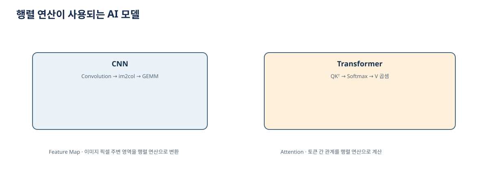

### CNN

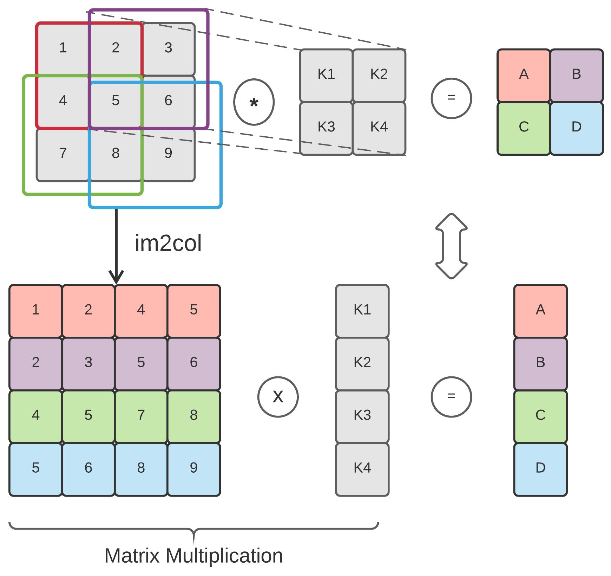

- Convolution
- im2col
- Feature Map
- Matrix Multiplication

### Transformer

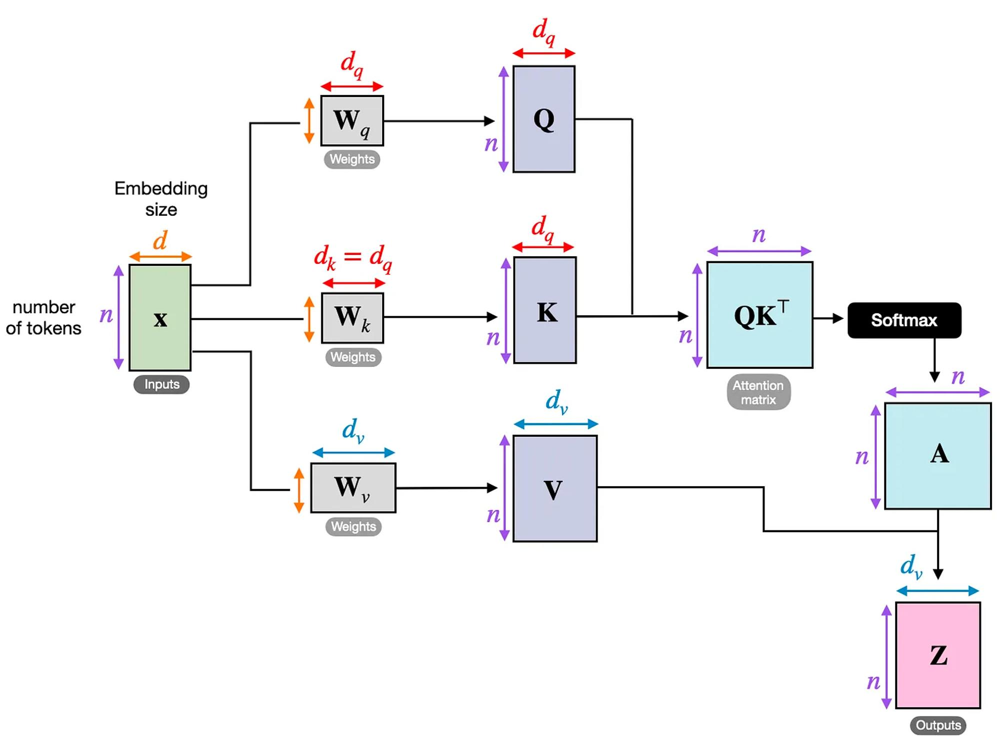

- Q, K, V
- Attention
- Softmax
- MLP

CNN과 Transformer 모두 내부적으로 많은 행렬 연산을 수행합니다.

예를 들어 Transformer의 Attention은 다음과 같습니다.

$$
Attention(Q,K,V)=Softmax\left(\frac{QK^T}{\sqrt{d_k}}\right)V
$$

현재의 GEMM 시뮬레이터를 확장하면 QKᵀ 연산과 Attention 결과 계산까지 추적할 수 있습니다.

---

# 6. 실제 구현 프로젝트로 발전시킨다면?

현재 보유하고 있는 FPGA 및 NVIDIA GPU 환경을 활용한다면 다음과 같은 실습 프로젝트를 추천합니다.

## Project 1. Python GEMM Simulator

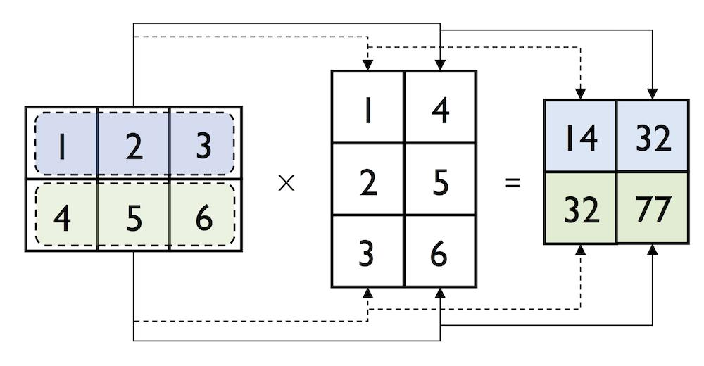

**가장 먼저 추천하는 프로젝트**

- Python / NumPy
- Matrix Tiling
- Batch 변경
- 연산 횟수 및 처리시간 측정

## Project 2. GPU Tensor Core

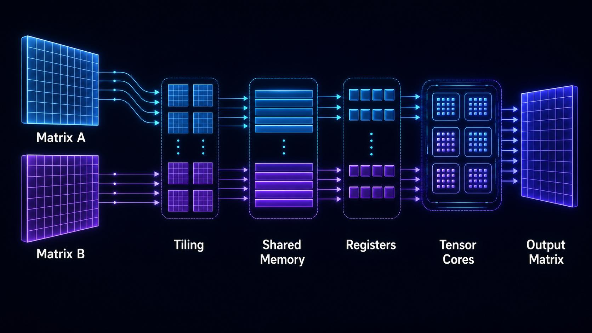

- CUDA
- cuBLAS
- FP16 / TF32 / INT8
- GPU 성능 비교

## Project 3. Verilog Systolic Array

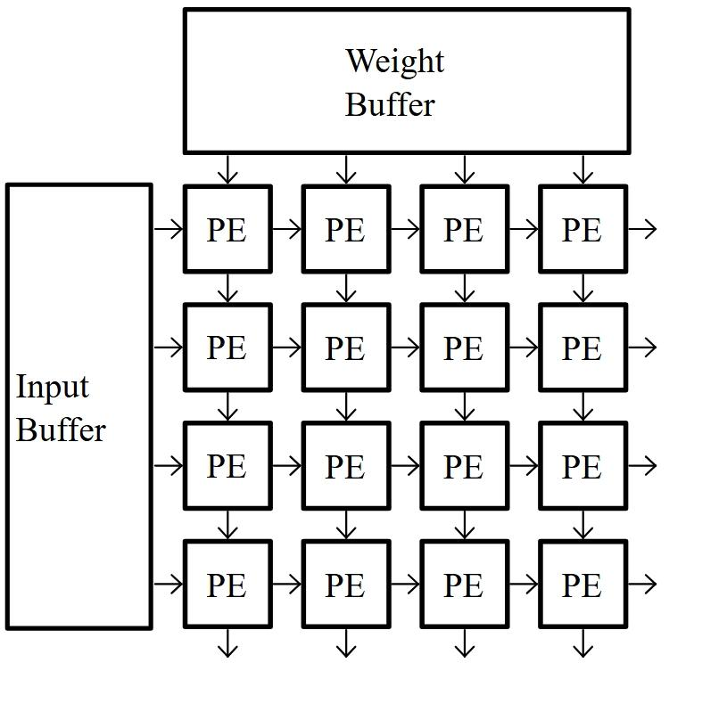

- 4×4 MAC Array
- PE 설계
- Pipeline
- BRAM / SRAM 인터페이스

## Project 4. FPGA AI Accelerator

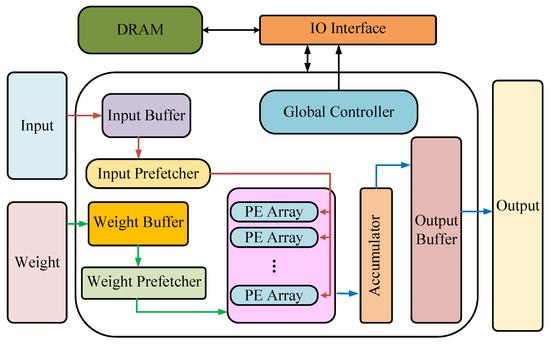

- AXI DMA
- AXI BRAM Controller
- GEMM IP
- PS-PL 데이터 전송

## Project 5. ASIC Accelerator

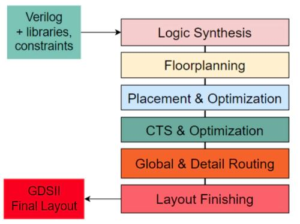

- RTL Synthesis
- Timing Analysis
- Area / Power
- Placement / Routing

---

# 7. 추가하면 좋은 시뮬레이터 기능

현재 두 파일을 교육용으로 더욱 발전시킨다면 다음 항목을 추가하는 것이 좋습니다.

| 확장 시뮬레이터 | 핵심 학습 내용 | 난이도 |
|---|---|---|
| MAC Simulator | 곱셈과 누산 | 기초 |
| Systolic Array | PE 간 데이터 전달 | 중급 |
| Memory Hierarchy | DRAM/SRAM/Cache | 중급 |
| Double Buffering | 데이터 전송과 연산 중첩 | 중급 |
| Quantization | FP32/INT8/INT4 | 중급 |
| CNN Accelerator | Convolution → GEMM | 고급 |
| Transformer Accelerator | Attention 및 GEMM | 고급 |
| Hardware Performance Model | TOPS, Bandwidth, Latency | 고급 |

특히 **TOPS와 실제 처리속도 비교** 기능을 넣으면 교육 효과가 상당히 좋아집니다.

예를 들어 연산기가 1 TOPS를 지원하더라도 메모리 대역폭이 부족하면 실제 성능은 그보다 훨씬 낮아질 수 있습니다. 이를 Roofline Model로 시각화할 수 있습니다.

---

# 8. 최종적으로 이해해야 할 핵심

두 파일의 차이를 한 문장으로 정리하면 다음과 같습니다.

| 첫 번째 파일 | 두 번째 파일 |
|---|---|
| 어떻게 계산할 것인가? | 어떻게 데이터를 공급할 것인가? |
| 연산 병렬화 | 데이터 재사용 |
| Block / Tile | DRAM / SRAM |
| BATCH | Buffer / DMA |
| MAC 병렬성 | Memory Bandwidth |
| 계산 구조 | 실행 구조 |

이 두 가지를 합치면 AI 가속기의 전체 구조를 이해할 수 있습니다.

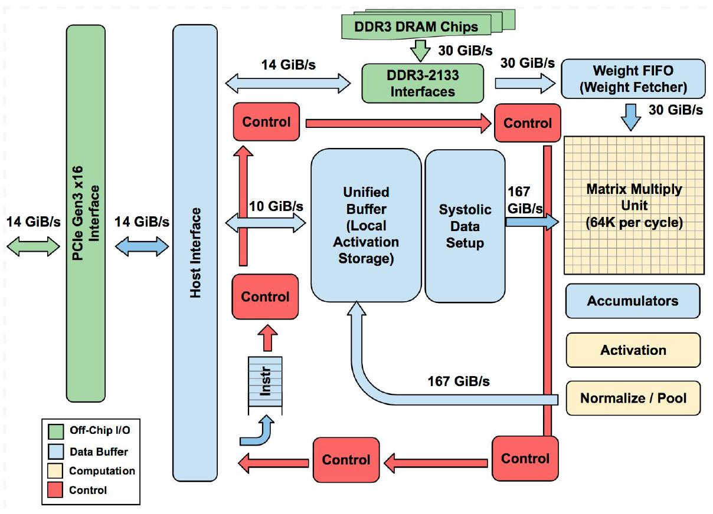

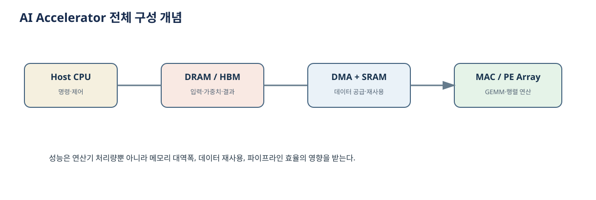

## 추천 학습 순서

1. 행렬 연산의 수학적 원리
2. 블록 연산과 병렬 처리
3. DRAM/SRAM 및 데이터 재사용
4. MAC 연산기와 Systolic Array
5. 실제 Verilog를 통한 하드웨어 구현
6. FPGA 검증 및 성능 측정

이렇게 진행하면 단순히 GPU와 NPU가 무엇인지 이해하는 수준에서 끝나지 않고, **AI 가속기의 연산 구조를 직접 설계하고 구현하는 과정**까지 연결할 수 있습니다.

---

# 9. 용어 정리

| 용어 | 의미 |
|---|---|
| GEMM | General Matrix Multiply, 일반 행렬 곱셈 |
| MAC | Multiply-Accumulate, 곱셈-누산 |
| PE | Processing Element, 연산 처리 요소 |
| Tile | 행렬을 나눈 계산 블록 |
| Tiling | 행렬을 타일 단위로 나누는 기법 |
| BATCH | 동시에 처리하는 입력 행 또는 샘플 묶음 |
| SRAM | Static RAM, 온칩 버퍼 등에 사용 |
| DRAM | Dynamic RAM, 메인 메모리 |
| DMA | Direct Memory Access, CPU 개입을 줄인 데이터 전송 |
| Accumulator | 중간 합을 누적하는 레지스터/저장 구조 |
| Systolic Array | PE들이 데이터를 전달하며 연속 계산하는 구조 |
| Quantization | 수치 정밀도를 낮추거나 표현을 변환하는 기법 |
| Roofline Model | 연산 성능과 메모리 대역폭 한계를 함께 분석하는 모델 |
| PPA | Power, Performance, Area |

# 10. 참고 및 범위

- `_01_block_matmul_math_sim.html`: 블록 분할, BATCH, 연산 병렬화와 행렬 계산 흐름의 근거 자료
- `_02_vta_block_gemm_sim.html`: DRAM, SRAM, inp_/wgt_/acc_, DMA, GEMM, STORE, 루프 순서 및 데이터 재사용의 근거 자료
- 이 문서의 GPU/NPU 일반 비교와 FPGA/ASIC 확장 제안은 두 시뮬레이터의 개념을 교육·설계 관점으로 확장한 설명입니다.
- 함께 제공하는 SVG 그림은 설명을 위해 새로 작성한 개념도이며, 특정 GPU/NPU 제품의 실제 회로도나 원본 시뮬레이터 화면 캡처는 아닙니다.
